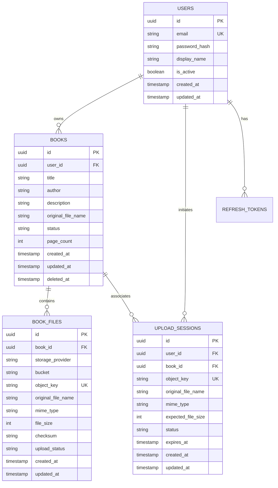

# ReadFlow Book Library Design Document

## 1. Overview & Objectives

The **Book Library** is ReadFlow's central document management hub. It enables authenticated users to manage their personal collection of English PDF books, view metadata, upload new books directly to Cloudflare R2 storage without passing file bytes through Vercel serverless functions, and safely download original PDFs through short-lived signed URLs.

### Core Principles
- **Zero-Cost Operation**: Utilizes Cloudflare R2 free tier (10 GB storage, $0 egress fees) and Neon PostgreSQL free compute.
- **Serverless Architecture**: Vercel Functions never buffer or process raw PDF file streams, avoiding Vercel payload limit (4.5 MB) and execution timeouts.
- **Strict Data Ownership**: Every book, file, and upload session is strictly scoped to the authenticated user (`userId`). Cross-user access is denied with HTTP 403.
- **Resilient & Idempotent**: Upload completion and deletion workflows handle network failures, session timeouts, and storage synchronization safely.

---

## 2. Database Entity Architecture

### Table Definitions & Constraints

#### `books`
- **Primary Key**: `id` (`UUID`)
- **Foreign Key**: `user_id` -> `users(id)` (`ON DELETE CASCADE`)
- **Status Lifecycle**: `pending` (upload initiated) -> `ready` (upload verified) -> `deleted` (soft deleted)
- **Soft Deletion**: `deleted_at` timestamp. Queries filter out records where `deleted_at IS NOT NULL`.
- **Indexes**:
  - `books_user_id_idx` on `(user_id)`
  - `books_status_idx` on `(status)`
  - `books_user_id_status_created_at_idx` on `(user_id, status, created_at DESC)` for high-performance library paging.

#### `book_files`
- **Primary Key**: `id` (`UUID`)
- **Foreign Key**: `book_id` -> `books(id)` (`ON DELETE CASCADE`)
- **Storage Target**: `storage_provider: 'r2'`, `bucket: 'readflow-pdfs'`
- **Object Key**: Structured unforgeable path: `users/{userId}/books/{bookId}/{uuid}.pdf`
- **Indexes**:
  - Unique index on `object_key`
  - Index on `book_id`

#### `upload_sessions`
- **Primary Key**: `id` (`UUID`)
- **Foreign Keys**:
  - `user_id` -> `users(id)` (`ON DELETE CASCADE`)
  - `book_id` -> `books(id)` (`ON DELETE SET NULL`)
- **Status Values**: `pending`, `completed`, `cancelled`, `expired`, `failed`
- **Lifecycle Expiration**: `expires_at` defaults to `now() + 15 minutes`.
- **Indexes**:
  - Unique index on `object_key`
  - Index on `user_id`
  - Index on `status`
  - Index on `expires_at`

---

## 3. Storage & Quota Constraints

| Parameter | Configuration | Free-Tier Allowance |
|---|---|---|
| **Max Single PDF Size** | `MAX_PDF_SIZE_BYTES=52428800` (50 MB) | Unlimited files up to account quota |
| **Max User Storage Quota** | `MAX_USER_STORAGE_BYTES=524288000` (500 MB) | Fits ~20 users on Cloudflare R2 10 GB free tier |
| **Cloudflare R2 Free Tier** | 10 GB total storage | \$0.00/month |
| **Class A Operations** (PUT, List) | 1,000,000 requests/month | \$0.00/month |
| **Class B Operations** (GET, Head) | 10,000,000 requests/month | \$0.00/month |
| **Egress Bandwidth** | Unlimited to internet & Vercel | \$0.00/month |

---

## 4. Frontend UI Architecture

### Components Hierarchy
- `HomePage.jsx`: Container page providing user profile context, header, and sign-out action.
  - `LibraryView.jsx`: Main view controller managing books state, search debounce, sort order, and view mode.
    - **Header Controls**: Search input (debounced 300ms), Sort dropdown (Newest, Oldest, Title A-Z), View Toggle (Grid / List), and `+ Upload PDF` button.
    - **Data Presentation**:
      - `BookCard.jsx`: Card view for grid layout displaying book icon, 2-line truncated title, author, formatted file size, creation date, and dropdown action menu.
      - `BookListItem.jsx`: Compact list row optimized for scanning large document collections.
      - **Empty State**: Friendly illustration and call-to-action when no books exist.
      - **Loading State**: Clean indicator during network fetches.
      - **Pagination Bar**: Previous / Next controls with page count indicator.
    - **Modals**:
      - `BookUploadModal.jsx`: Drag-and-drop file upload with progress bar (0%-100%), cancel/retry, and real-time status transitions.
      - `BookEditModal.jsx`: In-place editing of title, author, and description.
      - `BookDeleteModal.jsx`: Danger confirmation modal with explicit warning before permanent file removal.

### User Flow
1. User logs in -> views `HomePage` with `LibraryView`.
2. User clicks `Upload PDF` -> drag-and-drops PDF -> titles auto-fills from filename.
3. User clicks `Start Upload`:
   - Frontend calls `POST /api/v1/uploads/initiate` to receive pre-signed PUT URL.
   - Frontend uploads file bytes directly to Cloudflare R2 with Axios `onUploadProgress`.
   - Frontend calls `POST /api/v1/uploads/:uploadId/complete` to activate book.
4. Library refreshes automatically and displays the new book.
5. User can download the original PDF at any time via a temporary pre-signed GET URL.
