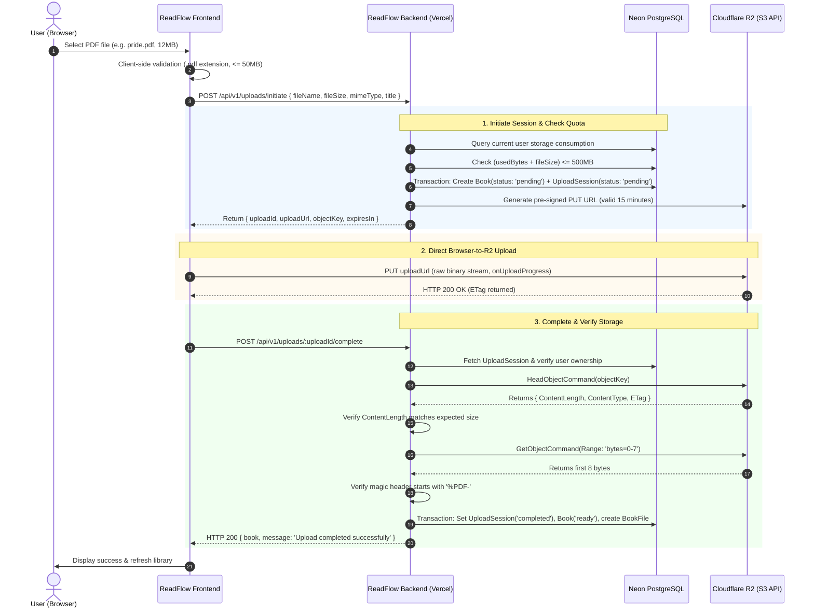

# ReadFlow Direct-to-Storage File Upload Flow

## 1. Upload Sequence Architecture

To operate strictly within the free tier of Vercel Hobby (which limits serverless function request bodies to 4.5 MB and has execution timeout limits), ReadFlow employs a **Direct Pre-signed PUT Upload Architecture**:



---

## 2. Step-by-Step Breakdown

### Step 1: Client Validation & Session Initiation
1. The user selects a file via file picker or drag-and-drop.
2. The browser validates:
   - File extension must end with `.pdf`.
   - File size must not exceed `52,428,800` bytes (50 MB).
3. The frontend sends metadata to `POST /api/v1/uploads/initiate`:
   ```json
   {
     "fileName": "clean_architecture.pdf",
     "fileSize": 14285700,
     "mimeType": "application/pdf",
     "title": "Clean Architecture",
     "author": "Robert C. Martin"
   }
   ```
4. The backend:
   - Verifies JWT access token (`req.user.sub`).
   - Validates input using Zod.
   - Calculates total active storage of the user across Neon database. If `currentUsed + fileSize > MAX_USER_STORAGE_BYTES`, returns HTTP 400 (`STORAGE_QUOTA_EXCEEDED`).
   - Generates an unguessable object key:
     `users/{userId}/books/{bookId}/{uuid}.pdf`
   - Atomically creates `Book` (status `pending`) and `UploadSession` in Neon.
   - Generates a pre-signed PUT URL using `@aws-sdk/s3-request-presigner` expiring in 15 minutes.
   - Returns session ID and `uploadUrl`.

### Step 2: Direct Binary Upload to Cloudflare R2
1. The browser initiates an HTTP `PUT` request directly to the Cloudflare R2 pre-signed URL:
   - Header: `Content-Type: application/pdf`
   - Body: `File` binary stream
   - Uses a dedicated Axios instance without app auth headers to prevent leaking JWT tokens to Cloudflare.
2. Progress tracking: The browser listens to `onUploadProgress` to calculate uploaded percentage in real time.
3. If the user clicks **Cancel Upload**, the browser calls `AbortController.abort()` to terminate the HTTP stream immediately, and notifies `POST /api/v1/uploads/:uploadId/cancel` to delete any partial data.

### Step 3: Verification & Activation
1. Once Cloudflare R2 responds with HTTP 200, the frontend notifies the backend via `POST /api/v1/uploads/:uploadId/complete`.
2. **The backend does NOT trust the client blindly**:
   - Checks that the session exists and belongs to the authenticated user.
   - Calls `HeadObjectCommand` on Cloudflare R2 to verify that the file actually exists in the private bucket.
   - Verifies that the actual stored size matches the expected size.
   - Issues a lightweight byte-range request (`bytes=0-7`) to verify the file signature starts with `%PDF-`.
3. If verification succeeds:
   - Database transaction activates the book: updates `Book.status` to `ready`, marks `UploadSession` as `completed`, and records `BookFile`.
   - Returns the completed book entity to the client.
4. If verification fails (e.g., file was not uploaded, or file is not a valid PDF):
   - Deletes the object from R2.
   - Marks session and book as failed/error.
   - Returns HTTP 400 with a detailed error code.

---

## 3. Idempotency & Error Scenarios

| Scenario | System Behavior |
|---|---|
| **Repeated Complete Calls** | If `complete` is called multiple times (e.g. user double-clicked or network retried), the endpoint detects `status === 'completed'` and immediately returns the existing activated book without re-creating files. |
| **Expired Pre-signed URL** | If an upload takes longer than 15 minutes, the user can call `POST /api/v1/uploads/:uploadId/refresh-url` to generate a fresh pre-signed PUT URL without losing book metadata. |
| **Corrupted / Fake PDF** | If a user renamed a `.exe` or `.png` to `.pdf`, the backend's `%PDF-` signature check rejects the file during completion, purges the object from R2, and marks the session failed. |
| **Orphaned Sessions** | Sessions that remain `pending` after `expiresAt` automatically transition to `expired`. |
